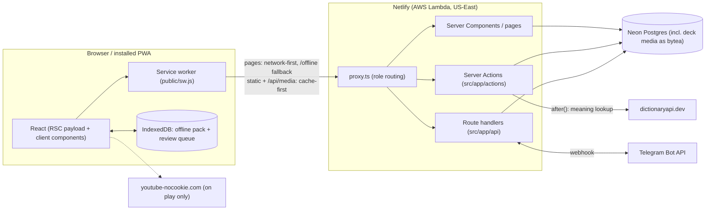

# Lingify — Project Overview for Engineering Review

_Written 2026-11-12 from the code on `main` (commit `fbaa551`); updated the same day for the homework verification
and test integrity work (PLAN.md §7). Audience: an engineer who has never seen the repo and is asked to review its
structure, design principles and feature direction. Sections 1–9 describe what exists; sections 10–13 are review
notes and open questions. Review items fixed since are marked **[fixed]**._

---

## 1. What the product is

Lingify is an installable web app (PWA) for **Uzbek students preparing for IELTS** and **their teachers**.

| Area | What students do | What teachers do |
|---|---|---|
| **Reading** (IELTS Academic passages) | Timed, proctored first try (fullscreen + tab lock, per-assignment rule) → score + band estimate. Wrong answers turn red, the correct answer is **never shown**. To re-check a wrong answer they must pick a new answer **and highlight the sentence that proves it** ("Prove it"). Once corrected, they tag *why* they missed it (Vocab / Distractor / Logic / Careless). | Upload passages as JSON, assign to a class or chosen students with a test-lock rule, see a homework matrix (first try / corrections / vocabulary + integrity badge, "Require retake"), a first-try heatmap with per-question time and answer order, mistake magnets, "stuck" alerts (≥3 failed tries), each student's tries/evidence/tags/event timeline. |
| **Listening** (YouTube lessons, e.g. TED-Ed) | Read key vocabulary first (gate), then IELTS Listening questions; same "never show the answer" correction loop. | Admins upload lesson JSON; teachers assign. |
| **Flashcards** (Anki) | AnkiWeb-like study (SM-2, max interval 20 days); time per card recorded to spot click-through. Decks: personal deck, one shared deck per assigned passage/lesson. One-click card from a highlighted phrase in a passage. Works offline. | Upload `.apkg` decks for their own passages (admins: decks for everyone). |
| **Progress** | Biggest bottleneck ("57% of mistakes are distractors in Matching Headings"), mistakes by type/cause. | Same breakdown per class; activity, streak, band per student. |
| **Telegram** (optional) | Link account → evening reminders. | Weekly class summary. |

**Hard product constraints** (these drive most technical decisions):

1. **Patchy internet in Uzbekistan** → offline flashcards and reading, tiny bundles, system fonts, no heavy deps.
2. **Free hosting only** (Netlify + Neon free tiers) → minimise DB wake-ups, writes, storage, function size.
3. **No paid AI** → card meanings come from a project glossary + dictionaryapi.dev.
4. **Pedagogy rule:** the correct answer must never reach the browser for a wrong item.
5. **Minimal UI**, must work at phone, tablet and desktop widths. Scope is deliberately narrow; features get *removed*
   rather than added (an earlier graded-reading library, placement test, goals etc. were deleted).
6. Scale target: ~30+ students and a handful of teachers per deployment (one school).

---

## 2. Tech stack

| Layer | Choice | Notes |
|---|---|---|
| Framework | **Next.js 16.4** (App Router, `cacheComponents`, `partialPrefetching`, experimental `useOffline`) | Uses `src/proxy.ts` (Next 16's replacement for `middleware.ts`). Read `node_modules/next/dist/docs/` before changing framework-level code — APIs differ from older Next. |
| UI | React 19.3, Tailwind CSS 4 | No component library, no icon font, system fonts only. |
| Language | TypeScript 5 (strict) | |
| DB | PostgreSQL 17 (Neon in prod) via **Prisma 7** + `@prisma/adapter-pg` | Client generated to `src/generated/prisma` (git-ignored). |
| Validation | Zod 4 | Upload formats, server-action inputs, API bodies. |
| Auth | Hand-rolled: bcryptjs + `jose` HS256 JWT in an httpOnly cookie | No auth library. |
| Anki import | `node:sqlite` (built-in) + `zlib` zstd + `fflate` (zip) | Reads legacy `collection.anki2/.anki21` and current `collection.anki21b`. |
| Tests | Vitest (unit only) | |
| Hosting | Netlify (Next adapter, AWS Lambda underneath, US-East) + Neon Postgres (US-East-2) | Every push to `main` deploys; migrations run in the build. |
| Runtime deps | 13 total | Deliberately small. |

Size: ~8.6k lines of TS/TSX in `src/`, `scripts/`, `tests/`; 146 tracked files; 23 commits.

---

## 3. Repository layout

```
content/                  Built-in IELTS passages (JSON, same format as uploads) + glossary.json (EN→definition/UZ)
prisma/
  schema.prisma           Data model (§5)
  migrations/             8 migrations, applied by `prisma migrate deploy` on Netlify build
public/
  sw.js                   Hand-written service worker (§7.5)
  samples/                Example passage/listening JSON, demo .apkg
scripts/
  seed.ts                 Demo accounts + built-in content (`--content` = content only)
  apkg-builder.ts         Builds the demo .apkg
  telegram-bot.ts         Long-polling bot for local dev
  telegram-reminders.ts   Daily / weekly reminders (run manually; no scheduler)
src/
  proxy.ts                Route guard: redirects by session + role
  app/
    (auth)/login, signup  Public pages
    actions/              Server Actions — the main write API (§6.1)
    api/                  Route handlers — heartbeat, media, offline pack/sync, deck import, Telegram webhook (§6.2)
    student/              Student area: passages, listening, flashcards, progress, settings
    teacher/              Teacher area: classes, passages, listening, decks, settings
    offline/              Self-contained offline app served by the SW when the network is down
  components/             Shell, top bar, folders, offline sync status, video, UI primitives
  lib/                    Domain + infrastructure modules (server-only unless noted)
tests/                    Vitest unit tests (Anki scheduler, apkg reader, passage format/grading, time)
README.md / TASK.md / PLAN.md   Setup, current status, next-six-changes plan
```

### `src/lib` by responsibility

| Concern | Modules |
|---|---|
| Infra | `db.ts` (Prisma client, pool sizing for serverless), `session.ts` (JWT), `auth.ts` (cookie, `requireStudent/Teacher/Admin`), `rate-limit.ts` (in-memory), `time.ts` (school time-zone day math) |
| Reading | `passage-format.ts` (Zod schema for upload JSON, `answerKey`, `publicGroups` that strips answers, band table), `passages.ts` (attempt lifecycle: submit, retry, tag, visibility) |
| Listening | `listening-format.ts`, `listening.ts` (attempt as one JSON row, vocab gate, lesson deck) |
| Flashcards | `anki.ts` (pure SM-2 scheduler, isomorphic), `study.ts` (client-side session queue), `decks.ts` (visibility, study queue, `applyReviews`, deck counts via raw SQL), `apkg.ts` (reader), `anki-template.ts` (Anki template renderer), `deck-import.ts` (merge by Anki note ID, media cap) |
| Meanings | `glossary.ts`, `dictionary.ts` (dictionaryapi.dev, cached in `DictionaryEntry`), `chunk-meaning.ts` |
| Teacher analytics | `insights.ts` (error breakdown + type × cause matrix, heatmap with pacing, mistake magnets, stuck, homework matrix, flashcard speed), `class-overview.ts` (batched per-student summaries + flags) |
| Homework & integrity | `assignments.ts` (`proctoringFor`, `settleHomework`: the one place that decides "done"), `telemetry.ts` (shared Zod schemas and pure flag rules), `submissions.ts` (first-submission bodies, used by actions and the beacon route) |
| Test lock (client) | `use-test-proctor.ts` (fullscreen, visibility, blur, leave detection, guards, beacon), `use-question-telemetry.ts` (dwell time, answer times), `test-draft.ts` (sessionStorage backup); components `pre-test-gate-modal.tsx`, `test-proctor.tsx`, `integrity-banner.tsx`, `integrity-badge.tsx` |
| Offline (client) | `offline-store.ts` (IndexedDB), `offline-sync.ts` (queue + pack refresh, Web Locks), `offline-types.ts` |
| Misc | `assignments.ts`, `telegram.ts` |

---

## 4. Runtime architecture



Key points:

- **Writes go through Server Actions** (forms and imperative calls from client components). Route handlers exist
  only where a Server Action does not fit: binary responses (media), `sendBeacon` (heartbeat), ETag'd offline pack,
  multipart uploads, and webhooks.
- **Pages are always dynamic and personal**; the service worker never caches HTML except the `/offline` app.
- **Grading is server-side only.** `publicGroups()` strips answers before questions reach the client.
- **Flashcard scheduling runs in both places with the same code** (`src/lib/anki.ts`): the browser schedules each
  answer immediately (no network wait), queues it in IndexedDB, and the server replays the queue authoritatively in
  `applyReviews()`.

---

## 5. Data model

```mermaid
erDiagram
  User ||--o{ Class : teaches
  User ||--o{ Enrollment : ""
  Class ||--o{ Enrollment : ""
  Class ||--o{ Assignment : ""
  Assignment ||--o{ AssignmentRecipient : ""
  User ||--o{ AssignmentRecipient : ""
  Assignment }o--o| Passage : "passageId (XOR)"
  Assignment }o--o| ListeningLesson : "lessonId (XOR)"
  User ||--o{ Passage : "owns (null = built-in)"
  Passage ||--o{ PassageAttempt : ""
  PassageAttempt ||--o{ QuestionAnswer : "one row per question"
  ListeningLesson ||--o{ ListeningAttempt : "answers in one JSON column"
  Passage |o--o| Deck : "passageId unique"
  ListeningLesson |o--o| Deck : "lessonId unique"
  User |o--o| Deck : "ownerId unique (personal)"
  Deck ||--o{ Card : ""
  Deck ||--o{ DeckMedia : "bytea"
  Card ||--o{ CardState : "per-user schedule"
  Card ||--o{ ReviewLog : ""
  User ||--o{ ActivityTime : "seconds per day per activity"
```

| Model | Purpose / notable design |
|---|---|
| `User` | `role` STUDENT/TEACHER. Admin = email in `ADMIN_EMAILS` env (not a DB flag). Telegram link codes. |
| `Class`, `Enrollment` | Teacher-owned class with 6-char join code. |
| `Assignment` + `AssignmentRecipient` | Polymorphic: exactly one of `passageId` / `lessonId` (DB CHECK since 2026-11-12). `proctoringPolicy` (STRICT/WARN_ONCE/NONE) and `requireVocabFirst` per assignment; per recipient `firstSubmitAt`, `vocabCompletedAt`, `integrityFlagged`. Recipients are explicit rows, so "whole class" = snapshot of current members. `completedAt` per recipient. |
| `Passage` | Content stored as `paragraphs String[]` + `groups Json` (validated upload format). Denormalised `paragraphCount`, `questionCount` for list views. |
| `PassageAttempt` / `QuestionAnswer` | Relational: one row per question with full `history Json` of tries + evidence, `errorTag`, `evidenceOk` (location vs comprehension error). Score/band from first submission only. Attempt also holds `testStartedAt` (server clock), `submissionReason`, `integrityFlagged`/`integrityReasons`, `integrityEvents` and `telemetry` (JSON), and `invalidatedAt` (teacher required a retake; excluded from all analytics). |
| `ListeningLesson` / `ListeningAttempt` | Deliberately **one row each**; per-question state in one JSON column so a check is 1 read + 1 write. `vocabSeenAt` = vocabulary gate. Same integrity/telemetry columns as passage attempts. |
| `Deck` | Four kinds distinguished by nullable columns: personal (`ownerId`), passage (`passageId`), lesson (`lessonId`), legacy global (all null). |
| `Card` | Pre-rendered `front`/`back` HTML. `ownerId` null = deck's own card; set = student's own highlight card inside a shared deck (visible only to them). `ankiNoteId` enables re-upload merge. |
| `DeckMedia` | Images/sounds as `bytea`, PK `(deckId, name)`, 20 MB cap per deck. |
| `CardState` / `ReviewLog` | Per-user SM-2 state; append-only log (also used for idempotency and daily limits). `ReviewLog.durationMs` = card shown → rated. |
| `archivedAt` on `Passage`, `ListeningLesson`, `Deck` | Soft delete: "Delete" archives; visibility helpers and lists filter it. |
| `ActivityTime` | Seconds per user/day/activity, upserted by heartbeat. |
| `DictionaryEntry`, `ChunkMeaning` | Caches for meanings. |

**Visibility rule** (core authorisation for students): a student sees a passage/lesson only if an
`AssignmentRecipient` row exists for them (`passageVisibleTo`, `lessonVisibleTo`). Decks follow their content
(`visibleDeckWhere` in `src/lib/decks.ts`), applied to deck list, study queue, review sync, due badge and offline pack.

---

## 6. API surface

### 6.1 Server Actions (`src/app/actions/`)

| File | Actions | Guard |
|---|---|---|
| `auth.ts` | `signup`, `login` (rate-limited, constant-time unknown email), `logout` | public |
| `passage.ts` | `startAttempt`, `startTest` (stamps `testStartedAt`, returns the questions), `restartAttempt`, `submitPassage` (answers + `meta: {reason, events, telemetry}`), `retryAnswer`, `tagMistake` | student + visibility |
| `listening.ts` | `startListeningTest`, `submitLesson` (same `meta`), `recheckAnswer`, `markVocabularySeen`, `restartLesson` | student + visibility |
| `cards.ts` | `loadStudyQueue`, `addChunkCard` (+ background meaning via `after()`), `explainChunkCard`, `deleteOwnCard` | student |
| `student.ts` | join class, etc. | student |
| `teacher.ts` | `createClass`, `removeStudent`, `uploadPassage`, `deletePassage` (archives), `assignPassage`/`assignLesson` (one shared `assign`), `deleteAssignment`, `resetAttemptForRetake`, `deleteDeck` (archives) | teacher (ownership checked per class/passage); admin for global decks |
| `settings.ts` | Uzbek toggle, Telegram link | user |

### 6.2 Route handlers (`src/app/api/`)

| Route | Why it is a route, not an action |
|---|---|
| `POST /api/heartbeat` | `sendBeacon` on page hide; ≤60 s per beat, upserts `ActivityTime` + `User.lastActiveAt` |
| `GET /api/media/[deckId]/[name]` | Binary; `Cache-Control: immutable`, cached by SW |
| `GET /api/offline/pack` | One JSON with due cards (≤1 day ahead) + up to 6 passages; SHA-1 ETag → 304 |
| `POST /api/offline/sync` | Batched reviews (≤2000), idempotent by `(cardId, at)`, timestamps clamped to [now−30d, now] |
| `POST /api/decks/import` | Multipart `.apkg` upload |
| `POST /api/attempt-terminate` | `navigator.sendBeacon` from a test page that is closing or being left: same body as the submit action, idempotent |
| `POST /api/telegram/webhook` | Secret-token header check |
| `GET /auth/signout` | Clears cookie (used when a cookie outlives its user) |

---

## 7. Core flows

### 7.1 Passage attempt lifecycle (`src/lib/passages.ts`)

```mermaid
stateDiagram-v2
  [*] --> Gate: page load (attempt row, no questions sent)
  Gate --> InProgress: startTest (fullscreen request, testStartedAt, questions)
  InProgress --> Submitted: submitFirst (button / timer / proctor / beacon)\nreason + telemetry + flags, score, band
  Submitted --> Submitted: retryQuestion (new answer + highlighted evidence;\nrepeat answers refused; history appended)
  Submitted --> NeedsTag: a red question turns green
  NeedsTag --> Submitted: tagQuestion (VOCAB/DISTRACTOR/LOGIC/CARELESS)
  Submitted --> Completed: all green and tagged → completeAssignments
  Completed --> InProgress: restartAttempt (new attempt row)
```



- Double submit is idempotent (`firstSubmittedAt` check + unique `(attemptId, number)` → P2002 swallowed), which is
  what lets the action and the beacon both fire.
- Retries and tags run in an interactive transaction that locks the attempt row (`SELECT … FOR UPDATE`).
- A teacher's "Require retake" sets `invalidatedAt` and creates a fresh attempt; homework rows reset.
- Test lock and telemetry: see README → "Test lock" and PLAN.md §7.
- Explanations are only revealed for questions currently correct.
- `evidenceOk` compares the highlighted paragraph letter with the uploaded `evidence` letter.

### 7.2 Listening

Same correction philosophy, but storage is one JSON blob per attempt. Video is a ~20 KB thumbnail until play; the
player unloads on navigation (Next keeps up to 3 hidden pages alive via `<Activity>`; `LiteVideo` stops playback in a
`useLayoutEffect` cleanup). The lesson's vocabulary becomes a shared deck (`ensureLessonDeck`, created lazily).

### 7.3 Flashcards

1. Server builds a `StudyQueue` (`studyQueue()` in `decks.ts`): learning cards, reviews due today (batch 100), today's
   new cards, remaining daily limits.
2. Browser runs the session with `study.ts` + `anki.ts`; each answer is rescheduled locally and pushed to an
   IndexedDB queue (`recordReview`).
3. `sendQueue()` drains the queue to `/api/offline/sync`, one tab at a time (Web Locks).
4. Server `applyReviews()` re-runs the scheduler in answer order, skips duplicates and cards the student may not see,
   writes `CardState` upserts + `ReviewLog` (with `durationMs`) in one transaction, then lets `settleHomework`
   check the vocabulary part of any open passage homework.

SM-2 defaults: steps 1m/10m, graduating 1d, easy 4d, ease 250%, 20 new/day; **interval cap 20 days**.

### 7.4 Deck import (`apkg.ts` → `deck-import.ts`)

Unzip → read SQLite collection → render templates (`{{FrontSide}}`, conditionals, `cloze:`, `text:`) → rewrite media
URLs to `/api/media/{deckId}/…` → merge cards by `ankiNoteId` in batches of 500 → add media up to 20 MB/deck. Scripts
are stripped; cards render in a sandboxed iframe with the deck's CSS.

### 7.5 Offline / PWA

- `public/sw.js`: cache-first for `/_next/static`, icons and `/api/media`; network-first for navigations with a
  pre-cached `/offline` app (its own cache, rebuilt as a unit). Static cache trimmed to 300 entries.
- `OfflineSync` component (in the student layout) refreshes the pack and drains the queue; retry every 30 s.
- `/offline` studies flashcards with the same scheduler and shows passages read-only (questions need a connection,
  because answers stay server-side).
- Logout clears IndexedDB (shared laptops).

### 7.6 Highlight → flashcard

`addChunkCard` re-derives chunk + sentence from the **stored** passage (never trusts client text), creates a card owned
by the student in the passage's shared deck, and fills the meaning in `after()` (glossary → cached → dictionary).

### 7.7 Teacher analytics

`class-overview.ts` computes per-student summaries for N students in 4 queries (+3 for flags and flashcard speed on
the class page); `insights.ts` builds the error breakdown (with a type × cause matrix), the first-try heatmap (with
per-question time, answer order, proof paragraph and auto-finish blanks, all from the attempts query it already ran),
mistake magnets, the stuck list, the homework matrix (a fixed handful of queries per assignment) and flashcard speed
(one aggregate SQL query). Computed on page load, no materialised tables; badges come from the pure rules in
`telemetry.ts`.

---

## 8. Cross-cutting concerns

| Concern | Current approach |
|---|---|
| **AuthN** | 30-day HS256 JWT `{userId, role, name}` in httpOnly, SameSite=Lax cookie; `Secure` when request is HTTPS. `requireUser()` re-reads the user from DB per request (React `cache`). No revocation/rotation. |
| **AuthZ** | `proxy.ts` routes by role; every action re-checks role and ownership/visibility in its query `where`. Admin via env email list. |
| **Brute force** | In-memory per-email limiter (8 failures / 10 min) — per Lambda instance only. |
| **Security headers** | nosniff, `X-Frame-Options: SAMEORIGIN`, HSTS, Referrer-Policy, Permissions-Policy. CSP only on `sw.js`. |
| **Time** | All "day" logic in `APP_TIMEZONE` (`Asia/Tashkent`) via `src/lib/time.ts`; DATE columns stored as UTC midnight. |
| **DB connections** | Pool max 2 per Lambda, 10 locally; Neon pooled URL for app, direct URL for migrations. |
| **Performance** | Denormalised counts, batched queries, raw SQL for deck counts, ETag'd offline pack, lazy YouTube, system fonts. |
| **Errors / logging** | `console.error` only; no error tracking. |
| **i18n** | UI is English; Uzbek only in card glosses. |

---

## 9. Build, test, deploy

- `npm test` → Vitest unit tests for pure modules (scheduler, apkg reader, passage format/grading, time, integrity
  rules). With `TEST_DATABASE_URL`, `tests/proctor-lifecycle.test.ts` also runs against PostgreSQL (idempotent
  auto-finish, Prove-it phase, concurrent retries). Still **no** authorisation or end-to-end tests, and **no** CI
  other than the Netlify build.
- `npm run lint` → ESLint (`eslint-config-next`).
- Netlify build: `npm run db:deploy && npm run build`. A failed migration aborts the deploy; the old version keeps
  running.
- Seeding: `npm run db:seed` (demo accounts — never in prod), `-- --content` (built-in passages + demo deck).
- Telegram reminders: run manually from a laptop with the prod `DATABASE_URL`.

---

## 10. Known issues (already acknowledged by the owner)

From `TASK.md` / `PLAN.md`:

1. **Local `.env` points at the production database**; the latest migration was hand-written and never run with
   `prisma migrate dev`.
2. **Anyone can sign up as a teacher**; emails are not verified.
3. Login rate limit is per server copy.
4. ~~Deleting a passage hard-deletes its deck and history~~ **[fixed]**: archived instead (`archivedAt`).
5. Deck media is capped per deck but not deduplicated across decks; media lives in Postgres.
6. Netlify free plan: ~4.5 MB request body (large `.apkg` fail), US region (+0.2–0.3 s from Uzbekistan), Neon sleeps
   after 5 min.
7. Card meanings are weak for multi-word chunks; Uzbek glossary unreviewed.
8. Shared lesson vocab cards cannot honour each student's "show Uzbek" setting.
9. Telegram reminders are not scheduled.
10. Not started: vocabulary list (A–Z / by deck) and teacher analytics (time online, time per question, answer order).

---

## 11. Review notes — structural issues found in the code

Prioritised. File references are where to look; line numbers omitted where they drift.

### P0 — fix before more users

| # | Issue | Where | Suggestion |
|---|---|---|---|
| 1 | **Prod DB used for development.** One wrong `prisma migrate dev` or `db:seed` wipes live data. | `.env`, README | Separate local Postgres (Docker) or a Neon branch per developer; make `db:seed` refuse to run when `DATABASE_URL` host matches prod. |
| 2 | **Admin = unverified email.** Admin rights come from `ADMIN_EMAILS`, but signup does not verify email, so whoever registers that address first becomes admin. Same for teacher self-signup. | `src/lib/auth.ts` `isAdmin`, `src/app/actions/auth.ts` | Teacher signup behind an invite code or admin approval; store `isAdmin` in DB set by a one-off script; optionally email verification (magic link). |
| 3 | **No CI gate.** Netlify deploys whatever is on `main`; tests and typecheck are not enforced. | — | GitHub Actions: `tsc --noEmit`, lint, vitest, `prisma migrate diff --exit-code` against schema; branch protection on `main`. |
| 4 | **[fixed]** **Destructive cascades on content delete.** Now soft delete (`archivedAt` on passage, lesson, deck). | `deletePassage` in `src/app/actions/teacher.ts`; `onDelete: Cascade` on `Deck.passage`, `Card.deck`, `CardState`, `ReviewLog` | Soft delete (`archivedAt`) on `Passage`/`ListeningLesson`/`Deck`; filter in the visibility helpers (already centralised, so the change is small). |

### P1 — correctness and maintainability

| # | Issue | Where | Suggestion |
|---|---|---|---|
| 5 | **[fixed]** (row lock in `retryQuestion`, `tagQuestion`, `retryListening`; conditional update for listening first submit) **Lost-update races on JSON history.** `retryQuestion` reads `history`, then writes `[...history, new]` outside a transaction; two quick retries (double click, two tabs) can drop a try and bypass the "already tried" check. `tagQuestion` decides completion from a snapshot read before its own update. Listening attempts have the same read-modify-write pattern on one JSON column. | `src/lib/passages.ts`, `src/lib/listening.ts` | Either an interactive transaction with `SELECT … FOR UPDATE`, an optimistic `version` column, or (cleaner) an append-only `QuestionTry` table with a unique `(attemptId, number, answerNormalised)`. |
| 6 | **Two different attempt models** for the same pedagogy: relational rows for reading, a JSON blob for listening. Grading (`answerKey`) is shared, but lifecycle logic (submit/retry/complete/band) is duplicated. | `passages.ts` vs `listening.ts` | Extract a small "attempt engine" (pure functions: submit, retry, tag, isComplete) with storage adapters; or pick one storage model. Pure functions also become unit-testable without a DB. |
| 7 | **[half fixed]** (Assignment CHECK added; `Deck.kind` not yet) **Polymorphism enforced only in code.** `Assignment` "exactly one of passageId/lessonId" and `Deck`'s four kinds (by nullable column combos) are not DB constraints. | `prisma/schema.prisma` | Add `CHECK` constraints in a migration; add a `Deck.kind` enum to make queries and intent explicit. |
| 8 | **[fixed]** **Duplicated actions.** `assignPassage` and `assignLesson` are ~90% identical. | `src/app/actions/teacher.ts` | One `assign({classId, content: {passageId} \| {lessonId}, …})`. |
| 9 | **[fixed]** (split into `useAttempt`, `useHighlights`, `useTestProctor`, `useQuestionTelemetry`, `Timer`, `PassageText`, `Group`, `QuestionFooter`, `CardToast`) **Large client component.** `passage-practice.tsx` is 773 lines (timer, highlighting, evidence, retry, tagging, card creation, bottom bar). | `src/app/student/passages/[slug]/passage-practice.tsx` | Split into hooks (`useTimer`, `useHighlights`, `useAttempt`) and presentational parts; `listening-lesson.tsx` (326) can reuse the answer/bottom-bar pieces. |
| 10 | **Partial-failure on deck merge.** For passage decks, card batches commit one transaction at a time and media after; a failure midway leaves a half-merged deck. Cards removed from the Anki export are never removed. | `src/lib/deck-import.ts` | Stage then swap, or one transaction if size allows; decide policy for removed notes (archive). |
| 11 | **Process-local state on serverless.** Rate limiter map and `chunkMeaning` in-flight map assume one long-lived process. | `rate-limit.ts`, `chunk-meaning.ts` | Rate limiter in Postgres (`LoginFailure` table with TTL) or an edge KV; in-flight map is fine as a best-effort optimisation but document it. |
| 12 | **Upload limits disagree.** Route allows 200 MB and buffers the whole file in memory; platform caps at ~4.5 MB. | `src/app/api/decks/import/route.ts` | Client-side check matching platform limit now; long-term: direct-to-object-storage upload + background import. |
| 13 | **Session cannot be revoked**; role is baked into a 30-day JWT (DB re-check mitigates pages, but `proxy.ts` and route handlers trust the token's role). | `session.ts`, `proxy.ts`, `api/*` | Add `User.sessionVersion` in the token and compare in `requireUser`; route handlers should call `requireUser` rather than `getSession` alone. |
| 14 | **Heartbeat cost.** Every active student sends a request every 30 s with 2 writes (`ActivityTime` + `User.lastActiveAt`), keeping Neon awake. | `api/heartbeat/route.ts`, `activity-tracker.tsx` | 60–120 s interval; drop the `User` write (derive last active from `ActivityTime`/`ReviewLog`); piggyback on existing action calls when possible. |
| 15 | **Server actions throw bare `Error`s** for not-found/forbidden; client gets a generic failure. Mixed return conventions (`FormState`, `{error, view}`, throws). | `src/app/actions/*` | One `Result<T, {code, message}>` convention; reserve throws for bugs. |
| 16 | **[half fixed]** (schema comment) **Stale copy.** Root metadata still describes the removed graded-reading product; `ChunkMeaning` schema comment says meanings are "written by the AI". | `src/app/layout.tsx`, `prisma/schema.prisma` | Update. |

### P2 — scale and quality-of-life

| # | Issue | Suggestion |
|---|---|---|
| 17 | Media as `bytea` in Postgres, served through Lambdas (cost, cold starts, storage limit). | Object storage (Netlify Blobs / R2 / S3) keyed by content hash; card HTML references `/media/{hash}`; one-time migration rewriting card HTML. |
| 18 | Only pure-function tests. | Integration tests against a throwaway Postgres for actions and visibility (most security-critical logic lives in Prisma `where` clauses); Playwright for 3 flows: first try → prove it → tag; offline study → reconnect → sync; teacher assign → student sees. |
| 19 | No observability. | Sentry (or Netlify log drain) + a few structured events (sync failures, import failures, slow queries). |
| 20 | No CSP on app pages; Anki HTML is sanitised by stripping scripts. | Add a page CSP (nonce-based); verify the card iframe is `sandbox` without `allow-same-origin`. |
| 21 | Teacher analytics computed on every page load. | Fine at 30 students; at a few hundred, add materialised per-attempt summary columns updated on write. |
| 22 | Region latency (US). | When budget allows, an EU region (Frankfurt) for both app and DB. |

---

## 12. Design principles

### Already followed (keep these)

1. **Answers never leave the server.** Every view goes through `publicGroups()` / `viewOf()`.
2. **Never trust client content for derived data** (chunk cards re-read the stored passage; review timestamps
   clamped; visibility checked on every write).
3. **Idempotent writes** for anything a flaky network may resend (first submit, review sync).
4. **Same pure logic on client and server** (Anki scheduler) → instant UI, authoritative server.
5. **One row per read where possible** (listening attempt, denormalised counts) and **batched queries** for lists.
6. **Shared content, per-user state** (one deck per passage/lesson; per-user `CardState`; student cards marked by
   `ownerId`) — no per-student copies.
7. **Offline is a first-class path**, not an afterthought; logout clears device data.
8. **Small dependency surface**, system fonts, lazy third-party embeds.
9. **Remove features before adding** — scope discipline.

### Suggested additions

10. **Constraints in the database, not only in code** (CHECKs for polymorphic rows, unique keys for idempotency).
    Started: `Assignment_one_content`.
11. **Soft delete for anything students have history on.** Done for passages, lessons, decks.
16. **Measure in the browser, judge on the server.** Telemetry is collected client-side but every flagged number is
    recomputed server-side from raw times, and durations use the server clock when it has one.
17. **Signals, not verdicts.** Integrity flags carry their reasons and lead to a teacher's decision ("Require
    retake"), never an automatic penalty beyond the auto-submit the student was warned about.
12. **Domain logic as pure functions + thin persistence** (already true for Anki and grading; extend to attempt
    lifecycle and assignments) so most rules are unit-testable.
13. **One error/result convention** across actions and route handlers.
14. **Every write path has a test that a different student/teacher cannot reach it.**
15. **Environments are isolated** (dev ≠ prod), and deploys pass a CI gate.

---

## 13. Feature ideas (fit the constraints)

| Idea | Why it fits | Effort |
|---|---|---|
| **Offline first-try for passages**: ship questions (no answers) in the offline pack, queue the timed submission, grade on sync. | Biggest offline gap today; keeps "answers server-side". | M |
| **Vocabulary list** (planned): plain-text `word`/`meaning` columns on `Card`, paged A–Z or by deck. | Already designed in `PLAN.md` §6. | M |
| ~~Teacher analytics: time per question, answer order~~ | **Done** (PLAN.md §7). Time online per session still open. | – |
| **Adaptive assignment**: suggest next passage by the student's dominant error tag × question type. | Uses data already collected. | S–M |
| **Teacher-editable card meanings / glossary**, with a review queue for Uzbek glosses. | Fixes the weakest content without paid AI. | S |
| **Full mock test**: 3 passages / 60 min with one band. | Matches the real exam. | M |
| **Passage versioning** (immutable versions; edits create a new version). | Lets teachers fix typos without invalidating attempts. | M |
| **Scheduled Telegram reminders** via Netlify Scheduled Functions. | Removes manual step. | S |
| **FSRS scheduler option** instead of SM-2. | Better retention per review; pure function swap. | M |
| **UI in Uzbek/Russian** (simple message catalogue). | Audience. | M |

---

## 14. Questions for the reviewer

1. Is Server Actions-as-API the right long-term boundary if a native mobile app is planned, or should a thin typed
   HTTP API (route handlers) be introduced now?
2. Unify reading and listening attempts on one storage model — relational rows or JSON blob?
3. Is the free-tier Netlify + Neon setup worth keeping, or is a single small always-on VPS (EU) with Postgres simpler
   and cheaper at this scale (also removes the 4.5 MB upload limit, cold starts and per-instance state issues)?
4. Media: move to object storage now (before more decks are uploaded) or later?
5. Auth: keep hand-rolled JWT, or adopt a library (Auth.js / Lucia-style sessions table) for revocation and email
   verification?

---

### Getting started (for reviewers who want to run it)

```bash
npm install
cp .env.example .env   # point DATABASE_URL at a LOCAL Postgres, not production
npm run db:migrate
npm run db:seed
npm run dev            # http://localhost:3000 — demo logins in README.md (password lingify-demo)
```

Further reading in the repo: `README.md` (setup, formats, deployment), `TASK.md` (status), `PLAN.md` (next changes).
